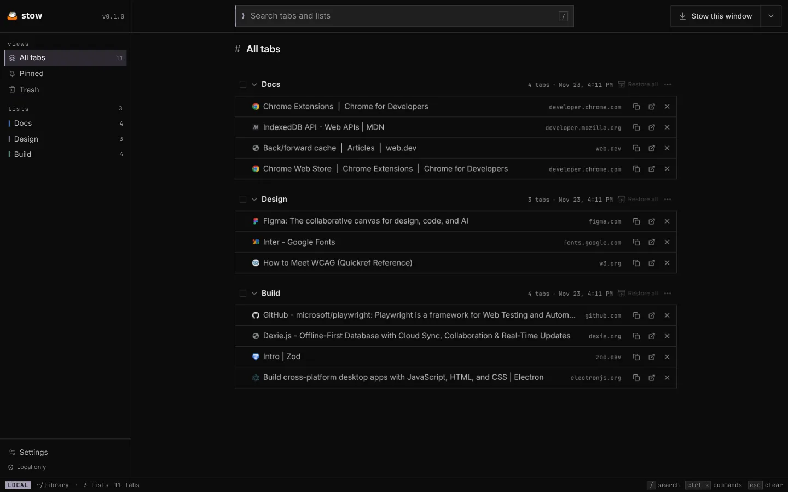

# Stow

[](https://github.com/code-sharad/stow/actions/workflows/ci.yml)
[](https://github.com/code-sharad/stow/releases/latest)
[](LICENSE)


Too many tabs open? Click once. Stow saves every eligible tab in the window as a searchable
**list**, closes the tabs, and gives the memory back. Restore one tab, or the whole list,
whenever you need it.

A local-first tab shelf for Chrome and Firefox. Everything lives in your browser profile. There
is no account, server, telemetry, or network request.

Stow is an MIT-licensed open source project.

 Read the [landing page](https://stow-tabs.vercel.app/)
for the short version.

> Stow is a working name. It is not affiliated with OneTab. Import is offered as a migration path;
> no OneTab code, artwork, or copy is used.

## What it does

- **Stow** a window, a tab, other tabs, tabs to the left/right, highlighted tabs, or every window.
- Native browser tab groups become their own lists; group names and colors are preserved.
- Search by title, URL, domain, or list name, including `domain:github.com`.
- Restore one tab, a selection, or a whole list into the current or a new window.
- Rename, pin, lock, collapse, reorder, move, merge, and deduplicate lists.
- Trash with Undo, retention (7/30/90 days or never), and explicit permanent delete.
- Import OneTab text, Stow JSON, Markdown lists, and Netscape bookmarks HTML.
- Export JSON; copy a list as Markdown or plain text.
- Dark-first console interface with a warm light variant, self-hosted Inter plus monospace
  details, comfortable/compact density, keyboard operation, and a command palette (`Ctrl/Cmd+K`).

## Install

Stow is not in the Chrome Web Store yet. Install the current build from the
[latest release](https://github.com/code-sharad/stow/releases/latest):

1. Download `stow-0.1.0-chrome.zip` and unzip it.
2. Open `chrome://extensions` and enable Developer mode.
3. Choose **Load unpacked** and select the unzipped folder.

Requires Chrome 120+ or another Manifest V3 Chromium browser.

### Firefox

Firefox is not in the add-on store yet either. Build the signed-ready package from source:

```bash
pnpm install --frozen-lockfile
pnpm zip:firefox     # writes .output/stow-0.1.0-firefox.zip
```

Then open `about:debugging#/runtime/this-firefox`, choose **Load Temporary Add-on**, and select
`.output/firefox-mv3/manifest.json`. Requires Firefox 140+, or Firefox for Android 142+.

The Firefox build targets Manifest V3 with `browser_specific_settings.gecko.id`
`stow-tabs@code-sharad.github.io`, and declares `data_collection_permissions.required: ["none"]`.

## Develop

Requirements: Node 22+, pnpm 10+, and a Chromium-based browser.

```bash
pnpm install
pnpm dev          # WXT dev server with the extension loaded
pnpm build        # production build in .output/chrome-mv3
pnpm build:firefox  # production build in .output/firefox-mv3
```

Load the unpacked extension:

1. Open `chrome://extensions` and enable Developer mode.
2. Choose **Load unpacked** and select `.output/chrome-mv3`.

If the browser does not show the extension after a rebuild, reload it from
`chrome://extensions`.

## Verify

```bash
pnpm lint
pnpm typecheck
pnpm test
pnpm test:coverage
pnpm build
pnpm e2e          # real Chromium + the built extension
pnpm check:tokens
pnpm check:network
pnpm check:landing
```

The end-to-end suite launches Chromium with a temporary profile. Set `CHROMIUM_PATH` to use a
different binary, or run under `xvfb-run` on a headless CI host.

## Landing page

The static landing page lives in `landing/` and has no build step or third-party runtime requests.

```bash
python3 -m http.server 4179 --directory landing
# http://127.0.0.1:4179
pnpm check:landing   # Playwright + axe at 320/375/640/768/1440, light and dark
```

The social image is generated from `landing/assets/og.svg`:

```bash
rsvg-convert -w 1200 -h 630 landing/assets/og.svg -o landing/assets/og.png
```

See [docs/LANDING.md](docs/LANDING.md) for the shipped copy, screenshots, and landing-page checks.

## Architecture

```
src/core        pure domain, IndexedDB repository, settings, import/export formats
src/platform    chrome.* adapters (tabs, windows, favicons)
src/services    stow, restore, badge, menus, backups
src/messaging   typed, Zod-validated message protocol and client
src/ui          React library, popup, settings, design tokens, state, i18n
src/entrypoints background service worker and HTML entrypoints
```

The service worker is stateless: every workflow commits to IndexedDB before it closes a tab.
Repository mutations publish a `ChangeSet` on `BroadcastChannel('stow:changes')`; the Library
applies deltas and resynchronizes on a revision gap or when the tab becomes visible again.

## Data and privacy

- Library data: IndexedDB database `stow` in the extension origin.
- Settings: IndexedDB plus two small `localStorage` mirrors for pre-paint theme/density.
- Favicons come only from Chromium's local `_favicon` cache. There is no favicon service.
- Uninstalling the extension removes its data. Export a JSON backup first if you want a copy.
- Optional scheduled backups request the `downloads` permission at runtime and write JSON files
  to your Downloads folder. Manual export needs no permission.

See [docs/PRIVACY.md](docs/PRIVACY.md). Brand assets live in [docs/BRAND.md](docs/BRAND.md);
the landing page implementation and copy are documented in [docs/LANDING.md](docs/LANDING.md).

## Permissions

| Permission | Why |
| --- | --- |
| `tabs` | Read titles/URLs and close or reopen tabs you ask Stow to save. |
| `tabGroups` | Preserve native groups as separate lists. |
| `storage` | Persist settings and library metadata. |
| `unlimitedStorage` | Keep large libraries from being evicted. |
| `contextMenus` | Right-click Stow actions. |
| `favicon` | Read cached favicons locally. |
| `alarms` | Trash retention and scheduled backups. |
| `downloads` (optional) | Only if you enable scheduled backups. |

No host permissions are requested, and the extension makes no network requests.

## Keyboard

| Shortcut | Action |
| --- | --- |
| `Alt+Shift+S` | Stow this window |
| `Alt+Shift+T` | Stow this tab |
| `Alt+Shift+L` | Open Library |
| `Ctrl/Cmd+K` | Command palette |
| `/` | Focus search |
| `F2` | Rename focused list |
| `Enter` / `Space` | Open tab / select |
| `Escape` | Clear search or selection |

Shortcuts can be remapped at `chrome://extensions/shortcuts`.

## Contributing

Stow is built in public and contributions are welcome. Read [CONTRIBUTING.md](CONTRIBUTING.md) for
setup, the product invariants, and the checks CI runs. By participating you agree to the
[Code of Conduct](CODE_OF_CONDUCT.md).

- Bugs and feature ideas: use the issue forms.
- Security reports: follow [SECURITY.md](SECURITY.md), never a public issue.
- Architecture and decisions: [docs/DECISIONS.md](docs/DECISIONS.md).

## License

[MIT](LICENSE) © 2026 Sharad Bhadait. Third-party dependencies retain their own licenses; see
[THIRD_PARTY_LICENSES.md](THIRD_PARTY_LICENSES.md).
