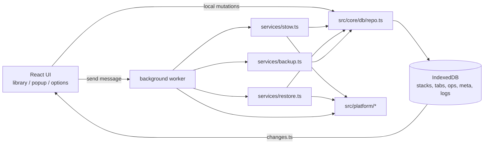

# Current architecture

This is the current module map and runtime flow. It supersedes the target layout in the historical briefs (`docs/00`–`docs/05`). When this document and the code disagree, the code and tests win; update this document in the same change.

## System shape

Stow is a Manifest V3 extension with three UI entry points and one background service worker:

- `library.html` — the full library, search, settings, trash.
- `popup.html` — a compact "stow this window / this tab" surface.
- `options.html` — redirects to the library settings route.
- The background worker owns privileged browser operations and durable workflows.

All library data lives in IndexedDB. Settings live in `chrome.storage.local`. There is no server, account, sync, analytics, or telemetry.

## Module map

| Path | Owns | May import |
| --- | --- | --- |
| `src/core/domain/types.ts` | Domain types, operation/restore shapes, tab candidate, group colors | nothing outside core |
| `src/core/domain/url.ts` | Scheme allow-list, URL size guard, `urlKey`, favicon sanitization | `src/shared/constants.ts` |
| `src/core/domain/ignore.ts` | Eligibility rules: internal pages, pinned, incognito, ignored sites, blank, window types | domain + settings types |
| `src/core/domain/plan.ts` | Pure stow planning: dedupe, ordering, target stacks, pin/lock rules | domain |
| `src/core/domain/dedupe.ts` | Duplicate candidates and stack merge planning | domain |
| `src/core/domain/order.ts` | Fractional `orderKey` helpers | domain |
| `src/core/domain/groups.ts` | Native tab-group ↔ stack mapping | domain |
| `src/core/db/schema.ts` | Dexie database and table indexes | Dexie, domain types |
| `src/core/db/repo.ts` | Every transaction: stow commit/verify, restore bookkeeping, deletes/undo/trash/purge, moves, imports, dedupe, meta/logs | domain, schema, formats, settings |
| `src/core/db/changes.ts` | Change-set pub/sub for the UI | domain |
| `src/core/io/formats.ts` | Detect/parse/serialize OneTab, Markdown, Netscape HTML, legacy JSON v1, full backup v2 | domain, settings |
| `src/core/settings/schema.ts` | Zod settings schema, defaults, normalization | zod |
| `src/core/settings/store.ts` | Settings persistence in `chrome.storage.local`, appearance mirror, subscriptions | schema, `chrome.storage` |
| `src/platform/tabs.ts` | Query/remove/create tabs; convert browser tabs to `TabCandidate` | `chrome.*` |
| `src/platform/windows.ts` | Window creation/focus helpers | `chrome.*` |
| `src/platform/favicon.ts` | Chromium favicon-cache URL and permission check; letter/host fallback | `chrome.*` |
| `src/services/stow.ts` | Save workflow: scope → classify → commit → verify → close | core, platform, repo |
| `src/services/restore.ts` | Restore workflow: load → open with durable progress → remove; owns tab-group/window creation specifics | core, platform, repo, queue, `chrome.tabs`/`chrome.tabGroups` |
| `src/services/backup.ts` | Backup format selection, alarm lifecycle, download permission | core/io, repo, settings, `chrome.alarms`/`chrome.downloads` |
| `src/services/queue.ts` | Per-worker serialization of stow/restore workflows | nothing |
| `src/services/badge.ts` | Action badge count | repo/platform |
| `src/services/menus.ts` | Context menus and commands | platform |
| `src/messaging/protocol.ts` | Zod message union, response types, `send()` | core types |
| `src/entrypoints/background.ts` | Listener registration, boot, dispatch, alarms, opening tabs/windows | services, messaging, repo |
| `src/ui/actions.ts` | UI mutation facade: local repo calls, remote messages, import/export | repo, messaging, formats |
| `src/ui/state/library.ts` | Zustand library state and change subscription | repo/changes |
| `src/ui/components/**` | React components, dialogs, lists, settings | state, actions, i18n |
| `src/shared/constants.ts` | Limits, schemes, tracking params, batch sizes, schema/url versions | no app code |

## Dependency rules

- `src/core/**` must not import `react`, `chrome`, `src/platform`, `src/services`, or `src/ui`. The deliberate exception is `src/core/settings/store.ts`, which owns the `chrome.storage.local` boundary.
- `src/platform/**` wraps reusable browser access and must not import React, services, or UI.
- `src/services/**` may import `core`, `platform`, and `repo`, but not React or UI. Services own workflow-specific browser APIs (alarms, downloads, permissions, menus, badge, tab groups) that do not belong in the reusable platform layer.
- `src/ui/**` may import state, actions, components, i18n, and core types. Prefer `actions.ts` over calling services.
- `src/messaging/protocol.ts` is shared by UI and background. Add a message there before adding a handler or caller.

`pnpm check:boundaries` enforces the core, settings, platform, and service rules. It does not scan tests, the background entrypoint, or UI imports.

## Storage model

Dexie database `stow`, schema version 1, tables:

| Table | Primary key | Indexes | Notes |
| --- | --- | --- | --- |
| `stacks` | `id` | `deletedAt`, `deletedBy`, `[deletedAt+pinned+orderKey]` | Soft-deleted lists; `tabCount` mirrors live tabs |
| `tabs` | `id` | `stackId`, `deletedAt`, `deletedBy`, `urlKey`, `[stackId+deletedAt+orderKey]`, `[deletedAt+urlKey]` | Soft-deleted saved tabs; `urlKey` is duplicate identity |
| `ops` | `id` | `createdAt` | Undo/restore operation records; `Operation.restore` is durable progress |
| `meta` | `key` | — | `lastBackupAt`, `lastPurge`, `rev`, schedule mode, etc. |
| `logs` | auto-increment | `ts` | Capped operational log; no URLs or titles |

Domain identities:

- IDs are ULIDs (`Id`).
- `orderKey` is a fractional string; use `src/core/domain/order.ts` instead of arithmetic on integers.
- `deletedAt = 0` means live. `deletedBy` is the operation that hid the row.
- `Stack.tabCount` is derived by repo writes; do not treat it as independent truth.
- `SavedTab.urlKey` is derived from the stored URL with tracking-stripping settings applied for duplicate detection only. The stored `url` is never rewritten.

## Stow flow

Entry points: action click, keyboard command, context menu, popup, or `stowScope` message.

1. Resolve the requested scope (`window`, `all-windows`, `tab`, `others`, `left`, `right`, `highlighted`) in `src/services/stow.ts`.
2. Read settings and classify candidates in `src/core/domain/ignore.ts`. Skipped reasons are counted, not silently dropped.
3. Map native tab groups to stack titles/colors when available.
4. Call `repo.commitFreshStow({ eligible, groups, settings, now })`:
   - the transaction reads the live URL index and locked stacks;
   - `src/core/domain/plan.ts` builds the plan with dedupe and destination rules;
   - stacks, tabs, and the `stow` operation are written together;
   - the returned `ChangeSet` lets the UI update.
5. `repo.verifyStow(plan)` re-reads the committed rows and confirms counts/URLs.
6. `ensureSurvival(...)` confirms the library tab or a safe fallback exists.
7. Only then `removeInBatches(...)` closes the browser tabs in batches of `BATCH_CLOSE`.
8. Any failure returns a code (`quota`, `write`, `verify`) and leaves browser tabs open.

Invariant: **save and verify before close**. If you change this sequence, add a test that injects a write/quota failure and asserts zero tabs were closed.

## Restore flow

Entry points: restore a stack, a selection, or a tab's saved match; `restore` message.

1. `repo.loadForRestore(...)` returns live saved rows and their intended order.
2. Unsafe schemes are filtered out before any browser call.
3. `repo.beginRestoreOp(...)` writes an `Operation` with `RestoreOpState.rows` all `pending`, before the first tab opens.
4. `openTabs(...)` opens in chunks of `BATCH_RESTORE`; after each chunk `repo.markRestoreRows(...)` records `opened` plus the browser tab id.
5. If the request removes saved rows, `removeOpened(...)` marks `removed` only for rows that were actually deleted after the replacement opened.
6. A worker restart can call `resumeNow(opId)` / `resumeRestore`:
   - only `pending` rows are loaded and opened;
   - already `opened`/`removed` rows are not reopened;
   - duplicate/absent saved rows are reconciled without repeating side effects.
7. `pendingRestoreOps()` feeds the library "Resume restore" toast and the background boot log.

Invariant: **open before remove**, and every side effect must be idempotent under retry.

`src/services/queue.ts` serializes work only within one worker lifetime. It is not a cross-worker lock; durable operation rows are what make restarts safe.

## Import, export, and backup

`src/core/io/formats.ts` is the only format boundary.

- Detection (`detectFormat`) content-counts OneTab rows, Markdown link rows, and headings; do not classify by file extension alone.
- Imports: OneTab text, Markdown, Netscape HTML, legacy Stow JSON `formatVersion: 1`, full backup `formatVersion: 2`.
- Full backup v2 (`buildFullBackup`, `serializeFullBackup`, `parseFullBackup`) includes settings plus stack/tab metadata: order, pin/lock/collapse, color, timestamps, favicon.
- Parsing is strict zod and fail-closed. Unknown fields, future versions, oversized files/URLs, and unsafe schemes are rejected or skipped with an `ImportIssue`; never partially apply a malformed backup.
- `repo.importBackup` validates and writes stacks/tabs/ops in one transaction, preserving metadata and assigning new ULIDs.
- Settings from an imported backup are shown for confirmation in the library; they are not applied automatically.
- Manual export and automatic backup use the same builder. `src/services/backup.ts` owns alarm scheduling and the download permission flow.

See [`../DECISIONS.md`](../DECISIONS.md) for why v2 carries settings and why legacy v1 import is permanent.

## Messaging

`src/messaging/protocol.ts` is the contract:

- A zod discriminated union defines requests: `stow`, `restore`, `resumeRestore`, `openLibrary`, `getEligibleCount`, `requestBackupPermission`.
- `Responses` maps each request to its result type.
- `send()` assigns a sender id and validates the response; the background checks the sender before privileged work.
- `src/entrypoints/background.ts` has one message switch. Add schema, response type, handler, and caller together.

Do not pass raw `chrome.tabs.Tab` objects across messages; use `TabCandidate`/IDs.

## Settings

- `src/core/settings/schema.ts` is the source of truth for keys and defaults. Every key has a `.catch(...)` fallback so old/corrupt storage cannot brick startup.
- `src/core/settings/store.ts` persists under `chrome.storage.local` key `settings`, mirrors theme/density to the document, and notifies subscribers.
- Settings that affect a workflow must be read at workflow start, not cached in a module global.
- Adding a key usually touches: schema, defaults, settings UI, i18n, backup/import round-trip, and tests.

## Background lifecycle

`src/entrypoints/background.ts` calls `defineBackground` and registers listeners at the top level so MV3 can wake the worker for an event. On boot it opens the DB, binds popup behavior, refreshes the badge, runs purge/backup alarm reconciliation, and logs pending restores. `onInstalled` creates menus and can open the welcome/library route. `onStartup` can open the library based on settings. `onSuspend` is intentionally empty.

Never rely on module-level mutable state surviving a restart. Persist progress in IndexedDB (or `chrome.storage`) and make the next boot reconcile it.

## UI state

- `src/ui/state/library.ts` holds `rev`, `stacks`, `tabsByStack`, and `tabIndex` in zustand.
- It subscribes to `changes.ts`; `accept(change)` applies a change set or reloads when the revision indicates a skipped change.
- Local mutations go through `src/ui/actions.ts` to `repo.ts`; stow/restore and other privileged work go through `send()`.
- Keyboard, focus, light/dark, density, and live-region behavior are acceptance criteria.

## Historical documents

`docs/00-README-agent-brief.md` … `docs/05-hardening-plan.md` record the original build brief, domain rules, UI spec, code blueprint, and remediation plan. They contain an obsolete target tree and some claims that are no longer true (for example, Firefox favicon behavior). Use them for product intent, not for current paths or implementation facts.
