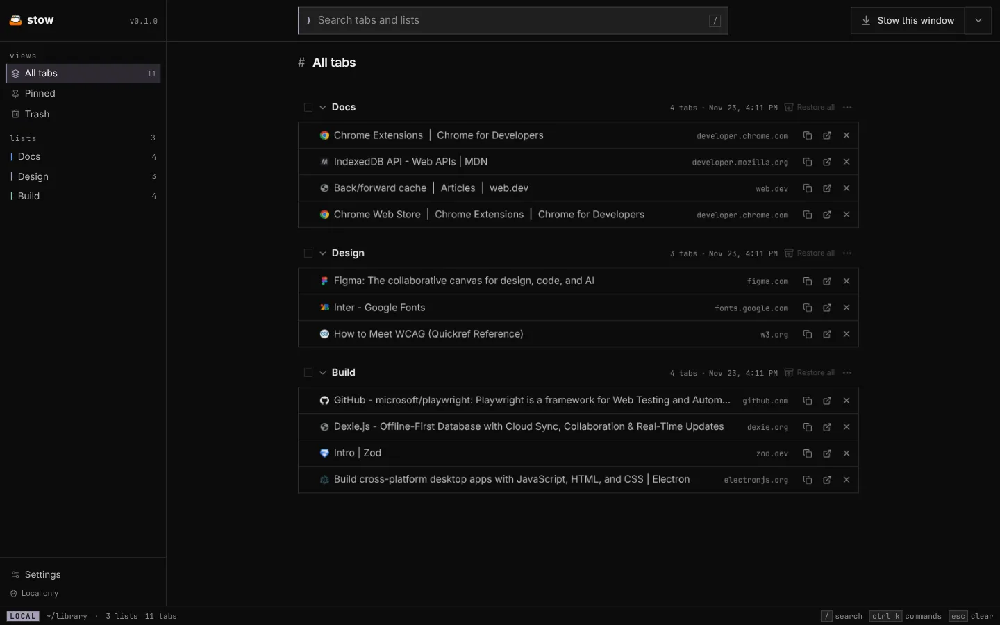

# Stow hero demo

> **Serve this over HTTP.** Chrome blocks module scripts and the Inter font from `file://`.
> Opening `landing/index.html` directly shows the library fallback and a “serve over HTTP”
> note instead of the animation. Run `python3 -m http.server 4179 -d landing` and open
> <http://localhost:4179/> (the player is at `/demo.html`).

An 18-second, seamless loop of Stow doing its real job: fifteen crowded tabs, the toolbar icon, the
library, a search, and a Docs restore. It is a vanilla ES module, not a video and not a React app:
the landing page is static HTML/CSS, so the demo mounts itself.

- Stage: **1280×720** (16:9), scaled to the figure. Below **1024px** it switches to a 4:5 camera
  crop (440×550, max 480px wide) that follows the action.
- Files: `landing/hero-demo.js` (engine, markup, timeline), `landing/hero-demo.css` (scoped `.sd-*`
  styles), `landing/demo.html` (standalone player), this README.
- No video and no runtime image assets on the animated stage: its only bitmap is the real Stow
  32px icon, inlined as a data URI; every other icon is inline SVG. The host includes the landing's
  existing library WebP as a no-JS / first-paint fallback, removed when the module mounts. Scoped
  CSS, transform/opacity per frame.
- The library, docs page, tab strip, copy, colors, and geometry are rebuilt from the extension’s
  actual components and tokens (`src/ui/components/*`, `src/ui/styles/*`). The default toolbar click
  stows the whole window and opens the library, so the demo never shows the opt-in popup.

## Embed

```html
<!-- once per page, after styles.css -->
<link rel="stylesheet" href="hero-demo.css?v=3" />
<script type="module" src="hero-demo.js?v=2"></script>

<!-- where the demo goes; .hero-shot is the landing figure -->
<figure class="hero-shot hero-shot--demo">
  <div
    class="hero-demo"
    data-stow-demo
    role="img"
    aria-label="A browser with fifteen crowded tabs. The Stow icon saves the window into grouped lists, the library opens, a search finds two lists, and the Docs list restores into a clean browser."
  >
    <picture class="hero-demo__fallback">
      
    </picture>
  </div>
</figure>
```

`[data-stow-demo]` mounts automatically unless it also has `data-manual`. The host reserves its
aspect ratio, so there is no layout shift. The fallback `<picture>` is hidden as soon as `.js` is on
`<html>` (the landing already does this), except on `file://`, where the inline `.is-file` class
keeps it visible and shows the “serve over HTTP” note; it keeps a real, themed library screenshot for
no-JS and for the first paint. Put the demo inside a positioned container; the host is `position: relative`
and clips the scaled 1280×720 surface.

To drive it manually:

```js
import { mountStowDemo } from './hero-demo.js';

const demo = mountStowDemo(document.querySelector('#stage'), {
  autoplay: true,      // false: render only the start frame
  loop: true,          // false: stop at 18s with the closing frame
  theme: 'auto',       // 'auto' | 'dark' | 'light'
  speed: 1,            // playback rate; 0.5 is a good inspection speed
  startAt: 0,          // seconds, 0–18
  onComplete: ({ time, loops }) => {}, // fires at 18s: each loop when looping, once when loop is false
});

demo.play(); demo.pause(); demo.seek(8.8);
demo.setSpeed(1.5); demo.setTheme('light'); demo.setLoop(false);
demo.getTime(); demo.duration; // 18
demo.destroy();
```

The same mount is available as `window.StowHeroDemo.mount(host, options)`. The instance is also at
`host.__stowDemo`. The demo pauses when it scrolls out of view (`IntersectionObserver`) and when the
tab is hidden, and it waits for `document.fonts.ready` before autoplay. Under
`prefers-reduced-motion: reduce` it renders the static payoff frame at **13.6s** and reports
`isPlaying() === false`; the demo page has an explicit play override.

## Timing knobs

Everything lives in `landing/hero-demo.js`.

| Constant | What it controls |
| --- | --- |
| `DURATION = 18` | Loop length; also the seek range and the reset timing. |
| `CURSOR_KEYS` | `{ t, x, y, cx, cy }` waypoints. Each segment is a quadratic Bézier; `cx`/`cy` are the control point, so moves curve. Repeat `t` to hold still before a click. |
| `CLICKS` | `{ t, x, y }` for the Stow icon, search, Restore all, and the restored Docs tab. The ripple and the 140ms cursor dip derive from these. |
| `CAM_KEYS` | Mobile-only `{ t, x, y }` camera waypoints. The crop is 440×550; the CSS switches to 4:5 at `max-width: 1024px`. |
| `STATIC_AT = 13.6` | The reduced-motion still (clean browser, restored Docs group). |
| `render(t)` staggers | Initial tabs collapse at `3 + i * 0.028`; final Docs tabs enter at `10.18 + i * 0.05`; library reveals use each node’s `data-d`. |
| reset crossfade | `easeInOut(seg(t, 16.9, 17.75))`: a duplicate opening frame fades in over the last second, so 18.000 matches 0.000. |

Other beats are in `render`: docs→library at 3.65–4.5, search focus 7.35, typing `indexeddb`
7.5–8.38, result crossfade 8.52–8.74, restore toast 10.0–10.24, active-tab switch 12.05,
library→docs 12.12–12.72. The search result and the stowed window both use the same seed data
(`GROUPS`), so the result counts and the restored group cannot drift apart.

The library content is deliberately positioned on the real grid: rail 220px, topbar 60px, status
26px, the max-860px reading column with its text at x=346 through x=1154, stack heads 34px, rows
30px. If you edit the stage or the reading width, update the markup builders and the cursor/click x
values together.

## Demo page and verification

Open `landing/demo.html` (served over HTTP, e.g. `python3 -m http.server -d landing 4179`, then
`http://localhost:4179/demo.html`). It exposes play/pause, restart, loop, a 0–18s scrubber, beat
buttons, 0.5–2× speed, theme switching, and `window.__demo` / `#t=8.8` seeking. The
`data-manual` attribute stops the auto-mount.

The landing checker covers the page around the demo:

```sh
pnpm check:landing   # or: node scripts/check-landing.mjs
```

It passes at 320/375/640/768/1440px in dark and light with reduced motion: no overflow, one H1,
13 images with alt/intrinsic dimensions, axe WCAG 2.2 AA, no console/page errors, and the no-JS
fallback. The demo layer is `aria-hidden`; the host carries the `role="img"` label; there are no
focusable elements inside.

Measured behavior (1280 stage, Chromium):

- Loop seam: 17.999 vs 0.001 differs by 2 antialiased pixels (AE 2.00392); 18 vs 0 is the same 2px;
  0 vs 0.001 is 0. The reset layer is fully in at 17.999 and fully out at 0.001.
- Mobile: the hero demo's library text is 12.2px at the 1120px figure, 11.1px at 390px, and 8.8px
  at 320px; the standalone demo page is 9.3px at a 320px viewport (its stage is a little wider).
- Offscreen: the timeline holds at the paused time and resumes when the demo returns.
- Reduced motion: time 13.6, static, light/dark respected.
- Weight: 59.7KB raw (36.5KB JS + 23.2KB CSS), **17.5KB gzip**. The 50KB target is met on the wire;
  a minifier will bring the raw files under it too if the source is not needed.

The icon data URI comes from `public/icon/32.png`; replace `ICON_32` if the brand mark changes. The
other SVGs are feather-style strokes sized 1–15px, chosen to match the extension’s Lucide icons.
