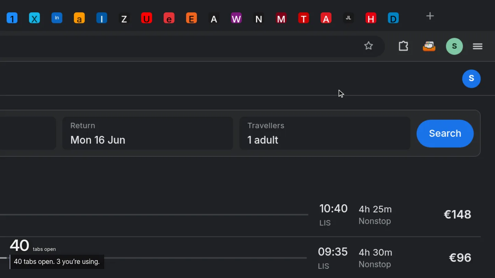

# Stow hero demo

> **Serve this over HTTP.** Chrome blocks module scripts and the Inter font from `file://`.
> Opening `landing/index.html` directly shows the poster fallback and a “serve over HTTP”
> note instead of the animation. Run `python3 -m http.server 4179 -d landing` and open
> <http://localhost:4179/> (the player is at `/demo.html`).

A 12-second, seamless loop of Stow doing its real job: forty crowded tabs, one click, a clean
window, the library, a search, and a restore. It is a vanilla ES module, not a video and not a React
app: the landing page is static HTML/CSS, so the demo mounts itself.

The story runs forwards — mess, relief, then recovery — because a first-time visitor needs to
recognise their own browser before they are shown a library:

| Time | Beat |
| --- | --- |
| 0–2s | Forty favicon tabs fill the strip while the camera pushes in and the counter climbs 12 → 24 → 40. Caption: `40 tabs open. 3 you're using.` |
| 2.9s | Cursor curves to the Stow toolbar icon and clicks. |
| 3.0–4.3s | Tabs drain right to left (26ms apart) into the icon. The strip is left holding one tab labelled `Stow`, the counter falls to 0, a window toast reads `Stowed 40 tabs · 3 lists`. Caption: `One click. Clean window.` |
| 5.0s | Hard cut into the library, lists sliding in. Caption: `Nothing lost.` |
| 6.9–8.4s | Search takes focus, types `flights`, and swaps to two matches in two lists. Caption: `Find anything.` |
| 9.5–10.7s | `Restore all` on the Trip list: eleven tabs enter the strip, the library toast reads `Restored 11 tabs · Trip`. Caption: `Pick up where you left off.` |
| 11.0–12s | The opening frame fades back in, so the loop point lands on the frame it left. |

- Stage: **1280×720** (16:9), scaled to the figure. Below **1024px** it switches to a 4:5 camera
  crop (440×550, max 480px wide) that follows the action.
- Files: `landing/hero-demo.js` (engine, markup, timeline), `landing/hero-demo.css` (scoped `.sd-*`
  styles), `landing/demo.html` (standalone player), this README.
- No video and no runtime image assets on the animated stage: its only bitmap is the real Stow
  32px icon, inlined as a data URI; every other icon is inline SVG, and the two site pages
  (a Google Flights result page and Chrome's new-tab page) are markup. The host ships a WebP poster
  as the no-JS / first-paint fallback, removed when the module mounts.
- The library, tab strip, copy, colors, and geometry are rebuilt from the extension’s actual
  components and tokens (`src/ui/components/*`, `src/ui/styles/*`). The default toolbar click stows
  the whole window and opens the library, so the demo never shows the opt-in popup.

## Embed

```html
<!-- once per page, after styles.css -->
<link rel="stylesheet" href="hero-demo.css?v=4" />
<script type="module" src="hero-demo.js?v=4"></script>

<!-- where the demo goes; .hero-shot is the landing figure -->
<figure class="hero-shot hero-shot--demo">
  <div
    class="hero-demo"
    data-stow-demo
    role="img"
    aria-label="A browser with forty crowded tabs. The Stow icon collapses them into a clean window, the library opens on three lists, a search for flights finds two lists, and the Trip list restores into the tab strip."
  >
    <picture class="hero-demo__fallback">
      
    </picture>
  </div>
</figure>
```

`[data-stow-demo]` mounts automatically unless it also has `data-manual`. The host reserves its
aspect ratio, so there is no layout shift. The fallback `<picture>` is hidden as soon as `.js` is on
`<html>` (the landing already does this), except on `file://`, where the inline `.is-file` class
keeps it visible and shows the “serve over HTTP” note; the poster is the demo’s own opening frame
(captured at 1.6s), so the still and the first second of the loop show the same thing. Put the demo
inside a positioned container; the host is `position: relative` and clips the scaled 1280×720
surface.

To drive it manually:

```js
import { mountStowDemo } from './hero-demo.js';

const demo = mountStowDemo(document.querySelector('#stage'), {
  autoplay: true,      // false: render only the start frame
  loop: true,          // false: stop at 12s with the closing frame
  theme: 'auto',       // 'auto' | 'dark' | 'light'
  speed: 1,            // playback rate; 0.5 is a good inspection speed
  startAt: 0,          // seconds, 0–12
  onComplete: ({ time, loops }) => {}, // fires at 12s: each loop when looping, once when loop is false
});

demo.play(); demo.pause(); demo.seek(7.4);
demo.setSpeed(1.5); demo.setTheme('light'); demo.setLoop(false);
demo.getTime(); demo.duration; // 12
demo.destroy();
```

The same mount is available as `window.StowHeroDemo.mount(host, options)`. The instance is also at
`host.__stowDemo`. The demo pauses when it scrolls out of view (`IntersectionObserver`) and when the
tab is hidden, and it waits for `document.fonts.ready` before autoplay. Under
`prefers-reduced-motion: reduce` it renders the still frame at **1.6s** (forty tabs, the counter,
the first caption) and reports `isPlaying() === false`; the demo page has an explicit play override.

## Timing knobs

Everything lives in `landing/hero-demo.js`.

| Constant | What it controls |
| --- | --- |
| `DURATION = 12` | Loop length; also the seek range and the reset timing. |
| `CURSOR_KEYS` | `{ t, x, y, cx, cy }` waypoints in stage pixels. Each segment is a quadratic Bézier, and `cx`/`cy` sit on the key that *starts* the segment (`{ t: 2.0, cx: 1130, cy: 250 }` shapes 2.0 → 2.78), so moves curve into the click instead of around it. Repeat `t` to hold still before a click. |
| `CLICKS` | `{ t, x, y }` for the Stow icon, the search field, and `Restore all`, in stage pixels. The ripple and the 140ms cursor dip derive from these, and the cursor is drawn in container pixels through the live camera (`(c − cam) × scale`), so its tip lands on the element it clicks at every zoom level and every figure width. |
| `CAM_KEYS_DESKTOP` / `CAM_KEYS_MOBILE` | `{ t, x, y }` camera waypoints; the desktop set also carries `z`, so it pushes from 2× into the strip end and pulls back to 1× at 4.15s. Both are pure `translate × scale` on one surface, so a frame costs one transform. |
| `STATIC_AT = 1.6` | The reduced-motion still (forty tabs, counter at 40, first caption). |
| `T_CUT = 5` | The beat where the library replaces the browser. It is a step, not a fade: `opacity` flips on one frame. |
| reset layer | `resetHTML()` duplicates frame zero in `.sd-reset` behind the stage, and it takes *that* frame's camera (`camAt(0)`), not the live one, so 11.999 and 0.000 composite the same pixels: the measured seam is 2 antialiased pixels. |
| `render(t)` staggers | Mess tabs drain at `3 + (39 - i) * 0.026`; restored Trip tabs enter at `9.55 + i * 0.05`; library reveals use each node’s `data-d`, and each node’s `data-r` marks it for the reveal pass. |

Other beats in `render`: the click ripple 2.9–3.36, the single `Stow` tab appearing 3.94–4.04 and
becoming active at 5, the URL bar swapping at 3.92 and 4.98, the library reveal 5.04–6.2, the search
focus 6.9, typing `flights` 7.0–7.78, the result crossfade 7.9, the `Restore all` hover 9.05–10.15,
the library toast 9.62–10.8, and the reset layer fading in 11–11.8. The stage HUD (counter and
captions) fades in over 0.22s and out over 10.6–10.85 so the seam is clean.

The content is one seed dataset: `LISTS` holds Trip (11), Work (14), and Shopping (15) — forty tabs,
three of which are the ones in use. The search query `flights` matches exactly two of them (the
Lisbon flight search in Trip, the Concur expenses page in Work), so the result count, the two result
stacks, and the restored Trip group cannot drift apart.

The library content is deliberately positioned on the real grid: rail 220px, topbar 60px, status
26px, the max-860px reading column with its text at x=346 through x=1154, stack heads 34px, rows
30px. If you edit the stage or the reading width, update the markup builders and the cursor/click x
values together. `CLICKS` must equal the element’s stage position: the verification below asserts
that each click point falls inside its target at 1440, 768, and 390px.

## Demo page and verification

Open `landing/demo.html` (served over HTTP, e.g. `python3 -m http.server -d landing 4179`, then
`http://localhost:4179/demo.html`). It exposes play/pause, restart, loop, a 0–12s scrubber, beat
buttons (mess, zoom, click, stow, clean, library, search, results, restore, tabs, payoff),
0.5–2× speed, theme switching, and `window.__demo` / `#t=7.4` seeking. The `data-manual` attribute
stops the auto-mount.

The landing checker covers the page around the demo:

```sh
pnpm check:landing   # or: node scripts/check-landing.mjs
```

It passes at 320/375/640/768/1440px in dark and light with reduced motion: no overflow, one H1,
images with alt/intrinsic dimensions, axe WCAG 2.2 AA, no console/page errors, and the no-JS
fallback. The demo layer is `aria-hidden`; the host carries the `role="img"` label; there are no
focusable elements inside, and the HUD text is sized from the figure (19px desktop, 13px mobile) so
it stays legible at half the recording size.

Posters are captured from the demo itself, not from the extension:

```sh
node scripts/capture-hero-poster.mjs   # landing/assets/hero-mess-{dark,light}.webp + mobile pair
```

It serves `landing/` on an ephemeral port, pauses `window.__demo`, seeks to `STATIC_AT`, screenshots
the stage at 1440×810 (desktop) and 480×600 (mobile, 4:5), and writes WebP at quality 82. Re-run it
after any change to the opening frame, the HUD, or the token colors.

Measured behavior (1280 stage, Chromium):

- Seam: the frame at 11.999 and the frame at 0 differ by 2 antialiased pixels (AE 2.29); 11.999 vs
  0.01 differs by 97 px, which is the HUD’s 0.22s fade-in and nothing else.
- Clicks: all three land inside their target boxes — Stow icon at 2.9s, search at 6.9s, `Restore
  all` at 9.5s — at figure widths 1440, 768, and 390.
- Weight: 39KB JS + 27KB CSS raw, **19.2KB gzip** (13.6KB + 5.6KB).
- Desktop camera: at 2× the visible window stays inside the stage at every key (stage x=634–652
  through 1274, y=0–360), so the crop never shows an empty edge before it pulls back to 1× at 4.15s.
- Library height: content 541px inside the 554px main column, so titles ellipsize instead of
  clipping.
- Offscreen: the timeline holds at the paused time and resumes when the demo returns.
- Reduced motion: time 1.6, static, light/dark respected.

The icon data URI comes from `public/icon/32.png`; replace `ICON_32` if the brand mark changes. The
other SVGs are feather-style strokes sized 1–15px, chosen to match the extension’s Lucide icons.
